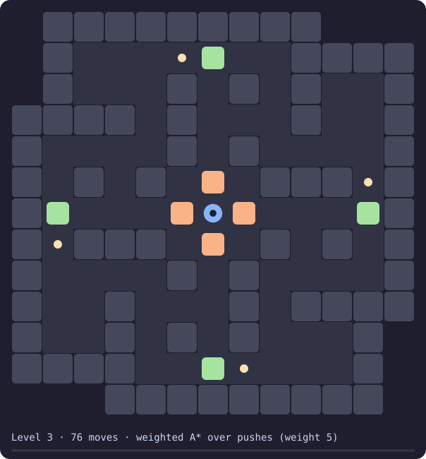
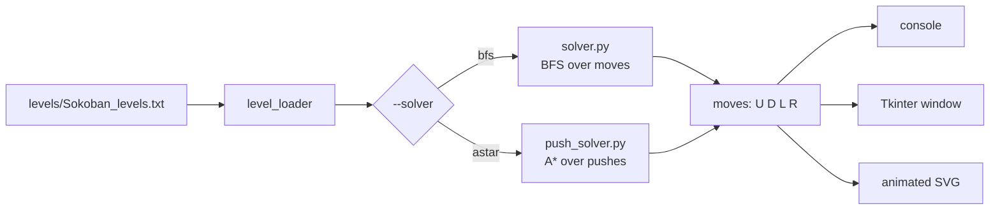
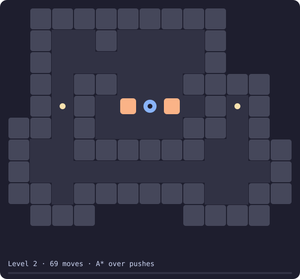

<div align="center">

# Dynamic Sokoban Pathfinding

**A Sokoban solver that finds the shortest solution, two ways, and shows it move by move.**




<sub>Level 3, eight boxes, solved in 76 moves. This picture is a file the solver wrote itself: <code>--svg</code>.</sub>

</div>

---

## What it does

You give it a level. It prints the moves that solve it (`U`, `D`, `L`, `R`), says how much work the search did and whether the answer is the shortest one, and opens a window where you step through the solution.

```console
$ python -m src.main 2 --no-visualizer
Level 2 loaded.
Player   : (4, 6)
Boxes    : [(4, 5), (4, 7)]
Targets  : [(4, 2), (4, 10)]

Solving...

Solution : D L U U D D R R U U L U L L L U L D D D D D L D R R R R R R R R D R U U U D D L L L L L L L L U U U U U R R R U R R R D L L L L L U L D D
Moves    : 69
Search   : A* over pushes
States   : 716 expansions, 757 distinct states reached
Time     : 0.06 s
Shortest : yes
```

## Two solvers, one answer

| | `--solver bfs` | `--solver astar` (default) |
|---|---|---|
| A state changes when | the player takes a step | a box is pushed |
| Order | breadth-first | A*, cheapest estimate first |
| Dead ends it skips | a box in a corner | dead squares, frozen 2×2 blocks |
| Answer | the shortest solution | the shortest solution (weight 1) |

Both were run on the four levels in `levels/Sokoban_levels.txt` (Python 3.14, one laptop):

| Level | Boxes | Moves | BFS over moves | A* over pushes |
|---|---:|---:|---:|---:|
| 0 | 2 | 3 | 4 expansions | 3 expansions |
| 1 | 5 | 6 | 22 expansions | 7 expansions |
| 2 | 2 | 69 | 13,479 expansions, 0.16 s | **716 expansions**, 0.06 s |
| 3 | 8 | 76 * | out of memory at 1.5 GB, after 78 s | weight 5: 19,337 expansions, 1.6 s |

\* **Not proven shortest.** See [Level 3](#level-3-and-the-weight).

The two solvers return solutions of the same length on levels 0 to 2, and on 450 random small levels in the tests.

<details>
<summary><b>Why pushes instead of steps</b></summary>

<br>

Most steps only walk the player around. Nothing about the puzzle changes until a box moves. So the push solver's graph is:

- **state**: the player's position right after a push, plus where the boxes are;
- **edge**: walk to the far side of a box, then push it one cell;
- **cost**: the steps walked, plus one for the push.

Any solution is a row of walks and pushes, and the cheapest walk between two pushes is a shortest path. So the cheapest route through this graph has exactly as many moves as the shortest solution the BFS finds.

Three things keep it small:

1. **Dead squares.** Before the search, a box is *pulled* backwards from every target. A cell it never reaches is a cell no box can leave towards a target, and no push onto it is tried.
2. **Frozen blocks.** Four cells in a 2×2 block that are all wall or box can never move again. If one of those boxes is not on a target, the state is dropped.
3. **A lower bound.** For every box, the fewest pushes to its nearest target on an empty board. It never overestimates, which is what makes the first solution A* takes off the queue a shortest one.

A state is stored as one integer (a bit per cell that holds a box, the player's cell in the lowest bits), so a few million fit in memory.

</details>



## Install and run

There is nothing to install: it uses the Python standard library only.

```bash
git clone https://github.com/DevCrazyCube/dynamic-sokoban-pathfinding.git
cd dynamic-sokoban-pathfinding
python -m src.main            # level 0, opens the window
```

- **Python 3.10 or newer** (the code uses `X | None` type hints). It was run on 3.14.
- **Tkinter** only for the window. If Python has no Tkinter or there is no screen, the solver says so and still prints the solution. On Debian or Ubuntu: `sudo apt install python3-tk`.

Run it from the project folder, as a module (`python -m src.main`), not as `python src/main.py`.

## Use

```bash
python -m src.main 2                       # solve level 2 and step through it
python -m src.main 2 --no-visualizer       # console only
python -m src.main 2 --solver bfs          # the same level with plain BFS
python -m src.main 3 --svg level-3.svg     # save the solution as an animation
python -m src.main 3 --weight 10           # faster, possibly longer
```

| Option | What it does |
|---|---|
| `level` | Which level in the file to solve. Default `0`. |
| `--solver astar\|bfs` | A* over pushes (default) or breadth-first over single moves. |
| `--weight N` | A* only. `1` finds the shortest solution. A larger weight finds one sooner that may be longer. Default: `1`, then `5` if the limit is reached. |
| `--limit N` | Stop after N expansions. Default: 100,000 for the shortest-solution search of A*, none otherwise. |
| `--svg FILE` | Save the solution as an animated SVG. |
| `--no-visualizer` | Do not open the window. |

Exit codes: `0` solved, `1` no solution or no such level, `2` stopped by `--limit` or a wrong option.

**The window** shows the solution one move at a time: **Next**, **Previous**, **Reset**, the step number and how many boxes are on a target. It is a viewer, not a playable game.

**The SVG** needs nothing to play: no script, no stylesheet, no font file. It opens in a browser and plays inside a README, like the one at the top of this page.

<div align="center">

<br><sub>Level 2: two boxes, 69 moves, the shortest there is.</sub>
</div>

## Level 3 and the weight

Level 3 has eight boxes. Neither search for the *shortest* solution finished on a laptop:

- the BFS ran out of memory at 1.5 GB after 78 seconds;
- A* with weight 1 ran out of memory at 2.3 GB.

So by default the solver looks for the shortest solution for 100,000 expansions (about ten seconds), and then switches to a **weighted** search and says so:

```console
$ python -m src.main 3 --no-visualizer
...
No shortest solution within 100,000 states. Switching to the weighted search (weight 5)...

Solution : U U U R R U U L L R R D D L L U D D D D D D D L L D D R R L L U U R R D U U U U L L L U U L L D D U U R R D D L R R R R R R R D D R R U U D D L L U U R
Moves    : 76
Search   : weighted A* over pushes (weight 5)
States   : 19,337 expansions, 33,636 distinct states reached
Time     : 1.55 s
Shortest : not proven (a weighted search can return a longer solution)
```

The weight multiplies the estimate of the work still to do, so the search goes for states that look close to solved. The price is the guarantee: with weight *w* the solution is at most *w* times the shortest, no better promise than that.

| Weight on level 3 | Moves | Expansions | Time |
|---:|---:|---:|---:|
| 1 | no answer | out of memory at 2.3 GB | |
| 3 | 76 | 299,101 | 27.9 s |
| 5 | 76 | 19,337 | 1.6 s |
| 10 | 88 | 390 | 0.04 s |

The 76 moves are a valid solution: the tests replay them under the plain rules of the game. Whether a shorter one exists is not known. On level 2, where the shortest is known to be 69, weight 5 returns 73.

## Level file

Levels live in `levels/Sokoban_levels.txt`, one after another, each under a `Level N (...)` line:

```
Level 0 (3 steps):
#######
#.$@$.#
#######
```

| Symbol | Meaning | Symbol | Meaning |
|---|---|---|---|
| `#` | wall | `.` | target |
| `@` | player | `*` | box on a target |
| `$` | box | `+` | player on a target |
| (space) | floor | | |

## Tests

```bash
python -m unittest
```

23 tests, about 12 seconds, standard library only. They check:

- both solvers against the lengths in the level file (3, 6 and 69 moves);
- that A* over pushes and the BFS return **the same length on 450 random small levels**, and agree on which have no solution;
- that every solution really solves its level, replayed by a separate, plain implementation of the rules;
- that the weighted search stays within its bound;
- the dead-square table on rooms where the answer is known by hand;
- the SVG: well-formed, one animation per piece, no script;
- the command line, its fallback and its exit codes.

## Repo layout

```
src/
  main.py          command line: load, solve, print, save, show
  level_loader.py  reads the level file
  state.py         the state the BFS uses, and the goal test
  moves.py         one step for the BFS, with the corner check
  solver.py        BFS over single moves
  push_solver.py   A* over pushes
  stats.py         the counters both solvers fill in
  output.py        console output
  svg_export.py    the solution as an animated SVG
  visualizer.py    the Tkinter window
levels/            the four levels
tests/             the tests
docs/              the two animations in this README
```

## Limits

- **Level 3 is not solved optimally.** 76 moves is the best found, not a proven minimum.
- **Small and medium levels only.** The deadlock checks are the simple ones (dead squares, 2×2 blocks). A level with many boxes in open space will run out of the limit or of memory.
- **The lower bound ignores other boxes** and lets two boxes aim for the same target, so it is loose on crowded levels.
- **Pure Python.** About ten thousand expansions a second on the laptop it was measured on. Timings in this README are from one machine and one run each.
- **The window was not opened while this README was written** (no virtual display on that machine). Its drawing code is unchanged from the first version; what was run is the console, the SVG export, the tests and the fallback without a screen (`Visualizer unavailable: ...`, exit code 0).

## About

Started as a data-structures course project: BFS, a hashable state and a step-through viewer. The push solver, the SVG export and the tests were added after. Built by directing AI coding agents (Claude Code).

## License

[MIT](LICENSE)
